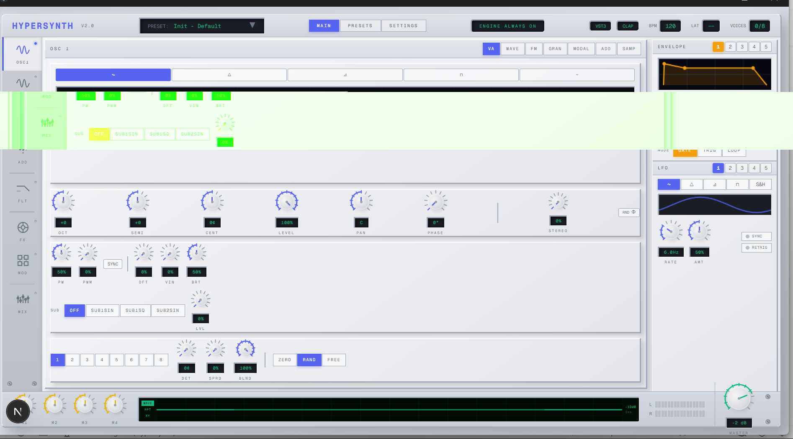

# HyperSynth — תוכנית פיתוח מלאה
### מנקודת המבט של מפתח DSP מקצועי (Steinberg / u-he / Arturia)

> **תאריך:** אפריל 2026  
> **מצב נוכחי:** UI מלא (~90%), Engine מינימלי (~12%), WASM Bridge (~8%)  
> **יעד:** סינתיסייזר עם כל שיטות הסינתזה, פעיל לחלוטין, ברמה מסחרית

---

## קונבנציות

- ✅ = מוכן
- ⚠️ = חלקי / באגי
- ❌ = לא קיים
- 📦 = ספרייה חיצונית מומלצת
- 🔧 = קוד עצמי

---

## Stack מעודכן לפרויקט

> **עדכון ארכיטקטוני (אפריל 2026):** מעכשיו שכבת ה-plugin, ה-standalone והמלצות ה-DSP במסמך הזה נשענות על סט הספריות הבא, והוא נחשב ל-baseline הרשמי של הפרויקט.
>
> **מדיניות רישוי:** הפרויקט מיועד למכירה מסחרית כ-closed-source. כל dependency ישירה חייבת להיות ברישיון permissive (MIT / Apache-2.0 / ISC / BSD / Unlicense / Zlib). ספריות GPL/LGPL/AGPL משמשות **כ-reference אלגוריתמי בלבד** — לא לשילוב ישיר בקוד.

### שכבת Plugin / Standalone
- 📦 **NIH-plug** (ISC) — הבחירה הראשית ל-CLAP/VST3, framework ב-Rust; רישיון ISC permissive, מותר לשימוש מסחרי סגור.
  - ⚠️ **הערת VST3:** שימוש ב-VST3 דורש הסכמה לרישיון VST3 של Steinberg (חינם, אבל חובה להירשם ב-[Steinberg Developer Portal](https://developer.steinberg.help/)). CLAP לא דורש שום הסכם.
- 📦 **clap-wrapper-rs** — אלטרנטיבה/תוספת ממוקדת ל-CLAP בלבד, לא הבחירה הראשית כרגע.

### פילטרים אנלוגיים
- 📦 **MoogLadders** — מאגר reference מרכזי למודלי ladder filters. מכיל מספר מימושים עם רישיונות שונים:
  - ✅ **Stilson** (Unlicense) — חופשי לחלוטין, מועדף להתחלת benchmark.
  - ✅ **Microtracker** (Unlicense) — חופשי לחלוטין.
  - ✅ **Krajeski** (Unlicense) — חופשי לחלוטין.
  - ✅ **Improved** (ISC) — permissive, מותר ל-closed-source.
  - ✅ **RKSimulation** (BSD) — permissive, מותר ל-closed-source.
  - ✅ **Oberheim** — מסומן כידידותי ל-closed-source במאגר.
  - **סדר עבודה:** Stilson/Microtracker/Krajeski → benchmark ראשוני, ואז Improved/RKSimulation/Oberheim → filter shootout מתקדם.

### פילטרים כלליים ו-IIR
- 📦 **DSPFilters** (MIT) — reference עיקרי ל-IIR general-purpose filters ולבדיקת תוצאות הנדסית.
- 📦 **iir1** — reference משלים לפילטרים כלליים.

### ריברב ואפקטים מרחביים
- 📦 **DaisySP** (MIT) — ה-reference המועדף לבניית algorithmic reverb, all-pass diffusers, early reflections. Building blocks מוכנים.
- 📦 **signalsmith-stretch** (MIT) — טוב במיוחד לכלי time/pitch processing ולחלק מהאפקטים המתקדמים (shimmer reverb וכו').
- 📦 **SignalSmithDSP** — משפחת references איכותית לפיתוח אפקטים מרחביים ו-spectral processing.
- 📦 **convolution / FFT-based processing** — `rustfft` (MIT/Apache-2.0) הוא ה-crate המועדף; convolution reverb ייבנה עליו בשלב מאוחר יותר.

### דיליי, קומב, All-pass, מודולציה
- 📦 **DaisySP** (MIT) — חזקה במיוחד כאן: delay lines, comb filters, all-pass filters, modulation blocks — כולם קיימים כ-building blocks.
- 📕 **synfx-dsp** (GPL-3.0-or-later) — reference אלגוריתמי מצוין לגישות delay/modulation, **reference בלבד — לא לשילוב בקוד!**

### דיסטורשן / Saturation / Waveshaping
- 📦 **DaisySP** (MIT) — כוללת bלוקי drive/saturation בסיסיים (tanh, soft clip, waveshaper).
- 📕 **synfx-dsp** (GPL-3.0) — כמאגר רעיונות ומיפויי distortion מגוונים, **reference בלבד — לא לשילוב בקוד!**

### אינדקסים ורפרנסים מקצועיים
- 📦 **awesome-musicdsp** — אינדקס העבודה הרשמי להמשך מחקר, papers, ו-reference implementations ברישוי מתאים.
- 📦 **signalsmith-stretch** — מקור טוב לבדיקת איכות מימוש והגישה של Signalsmith Audio.
- 📕 **synfx-dsp** (GPL-3.0-or-later) — **reference אלגוריתמי בלבד. לא לשילוב ישיר במוצר סגור.**

### ספריות נוספות — Rust (כולן permissive ✅)

#### Audio I/O & Format
- 📦 **hound** (Apache-2.0) — קריאה/כתיבה של WAV files. לסמפלר ו-wavetable loading.
- 📦 **symphonia** (MIT) — multi-format audio decoding (WAV, FLAC, OGG, MP3). לסמפלר עם תמיכה במגוון פורמטים.
- 📦 **creek** (MIT/Apache-2.0) — disk streaming audio בזמן אמת (קריאה מדיסק ב-background thread). שימושי לסמפלר עם קבצים גדולים.

#### Sample Rate Conversion & Resampling
- 📦 **rubato** (MIT) — ממיר sample rate איכותי עם sinc interpolation. **חיוני לסמפלר** — כשמנגנים sample בגובה שונה מה-root note.

#### FFT
- 📦 **rustfft** (MIT/Apache-2.0) — FFT בסיסי ומהיר. לwavetable mip-mapping בזמן build ו-spectral FX.

#### Real-time Communication (Audio Thread ↔ UI)
- 📦 **rtrb** (MIT/Apache-2.0) — wait-free SPSC ring buffer. **לתקשורת בין audio thread ל-UI** בלי locks. כבר בשימוש פנימי של NIH-plug.
- 📦 **ringbuf** (MIT/Apache-2.0) — חלופה ל-rtrb עם API שונה (HeapRb, StaticRb variants).
- 📦 **atomic_float** (MIT/Apache-2.0/Unlicense) — `AtomicF32` / `AtomicF64` ל-lock-free parameter sharing בין threads. **חיוני לפרמטרים שהUI וה-audio thread קוראים בו-זמנית.**

#### MIDI
- 📦 **midly** (Unlicense) — parsing של MIDI files ו-real-time events. zero-copy, `no_std`.
- 📦 **wmidi** (MIT) — MIDI message types, encoding/decoding. no-allocation, real-time safe.

#### DSP References (לא crates ישירים, אלא reference implementations)
- 📦 **fundsp** (MIT/Apache-2.0) — ספריית DSP מקיפה ב-Rust עם 30+ filters, wavetable oscillators, effects. שימושי כ-reference לבדיקת אלגוריתמים.
- 📦 **dasp** (MIT/Apache-2.0) — Piston's DSP primitives: samples, frames, interpolation, peak/RMS detection. `no_std`, zero-allocation.

#### Dev Tools
- 📦 **assert_no_alloc** (MIT) — ב-debug builds, panic אם audio thread מבצע allocation. **חיוני לוודא שה-DSP נקי.**

### ספריות נוספות — JS / Frontend (כולן permissive ✅)
- 📦 **wavesurfer.js** (BSD-3-Clause) — waveform visualization אינטראקטיבי. מתאים לתצוגת סמפל ב-sampler engine.
- 📦 **tone.js** (MIT) — Web Audio framework עם synths, effects, transport. שימושי לprototyping ו-Web MIDI utilities.
- ⛔ **peaks.js** (LGPL-3.0) — **לא לשימוש!** LGPL דורש גילוי קוד במוצר סגור.

### סט העבודה בפועל (הליבה)
> הסט המינימלי שמתחילים ממנו — כל השאר הוא reference או תוספת עתידית:

| ספרייה | תחום | רישיון | סטטוס |
|--------|------|--------|-------|
| **NIH-plug** | Plugin framework | ISC | ✅ כבר בשימוש |
| **MoogLadders** | פילטרים אנלוגיים | Unlicense/ISC/BSD | reference |
| **DSPFilters** | פילטרים כלליים | MIT | reference |
| **DaisySP** | אפקטים + בלוקי DSP | MIT | reference |
| **signalsmith-stretch** | Pitch/Time processing | MIT | reference |
| **rustfft** | FFT | MIT/Apache-2.0 | dependency (Phase 3+) |
| **hound** | WAV I/O | Apache-2.0 | dependency (Phase 3 Sampler) |
| **symphonia** | Multi-format audio | MIT | dependency (Phase 3 Sampler) |
| **rubato** | Resampling | MIT | dependency (Phase 3 Sampler) |
| **atomic_float** | Lock-free params | MIT/Apache-2.0 | dependency (Phase 1+) |
| **rtrb** | Lock-free ringbuf | MIT/Apache-2.0 | dependency (Phase 8) |
| **awesome-musicdsp** | אינדקס מחקר | — | אינדקס |

### ביקורת רישיונות — Dependencies קיימים בפרויקט
> **עדכון אחרון:** אפריל 2026

| Dependency | Crate/Package | רישיון | סטטוס |
|-----------|---------------|--------|-------|
| `libm` | Rust | MIT/Apache-2.0 | ✅ |
| `wasm-bindgen` | Rust | MIT/Apache-2.0 | ✅ |
| `nih_plug` | Rust (git) | ISC | ✅ |
| `anyhow` | Rust | MIT/Apache-2.0 | ✅ |
| `midir` | Rust | MIT | ✅ |
| `serde` | Rust | MIT/Apache-2.0 | ✅ |
| `serde_json` | Rust | MIT/Apache-2.0 | ✅ |
| `cpal` | Rust | MIT/Apache-2.0 | ✅ |
| `next` | npm | MIT | ✅ |
| `react` / `react-dom` | npm | MIT | ✅ |
| `@radix-ui/*` | npm (27 pkgs) | MIT | ✅ |
| `tailwindcss` | npm | MIT | ✅ |
| `tw-animate-css` | npm | MIT | ✅ |
| `lucide-react` | npm | ISC | ✅ |
| `electron` | npm | MIT | ✅ |
| כל שאר ה-npm deps | npm | MIT/Apache-2.0 | ✅ |

> **⚠️ לפני הוספת dependency חדש — לבדוק רישיון! אם הוא GPL/LGPL/AGPL — לא להוסיף.**

---

## PHASE UI — ביקורת עיצוב וסדר עדיפויות תיקונים

> **תאריך ביקורת:** אפריל 2026  
> **מנקודת המבט של:** מעצב UI מקצועי (Arturia / u-he)  
> **ציון כללי:** 6/10 — תשתית עיצובית חזקה, ביצוע חלקי

---

### UI.0 — הערכה כללית

העיצוב הכללי בכיוון הנכון — שלדת אלומיניום בהירה (light chassis), פאנלים בולטים (`panel-raised`), מסכי תצוגה שקועים (`panel-recessed`), טיפוגרפיה mono uppercase. זה הלוק של hardware synth מקצועי (Access Virus TI, Nord Lead).

**מה עובד טוב:**

| אלמנט | הערכה |
|--------|------|
| **Color system** | מערכת צבעים per-section (osc=blue, filter=purple, env=amber) — מקצועי, בסגנון Pigments |
| **`panel-raised` / `panel-recessed`** | Skeuomorphic 3D depth effect — זה בדיוק מה ש-hardware UI צריך |
| **Sidebar navigation** | OSC1-3 + FLT/FX/MOD/MIX — אייקונים ברורים, LED indicators, workflow טבעי |
| **Header bar** | Preset display + format badges (VST3/CLAP) + BPM + voice count — מקצועי |
| **Bottom bar layout** | Macros → Scope → VU → Master — flow נכון, כמו ב-Virus TI |
| **Knob design** | Radial gradient + tick marks + value arc — נקי ופונקציונלי |
| **Envelope/LFO side panel** | 5 envelopes + 5 LFOs עם color coding per instance — מצוין |
| **Unison section** | Voice count + DET/SPRD/BLND + phase mode — כל הפרמטרים הנכונים |
| **Engine switching** | VA/WAVE/FM/GRAN/MODAL/ADD/SAMP — מתחלף חלק, כמו Pigments engine selector |
| **2D/3D wavetable toggle** | אלגנטי ומקצועי |

---

### UI.1 — בעיות קריטיות (חוסמות מוצר)

#### UI.1.1 — תצוגת FM Algorithm שבורה ויזואלית

**קובץ:** `components/synth/FmAlgorithmDisplay.tsx`, `components/synth/panels/OscillatorPanel.tsx`

**באג:** ב-Algorithm 1 (4→3→2→1\*), מוצג רק OP4. שלושה אופרטורים נחתכים.  
**סיבה:** `height={100}` קבוע ב-CSS pixels, אבל ה-layout מחשב positions ב-grid ש-row מגיע עד 2 — עם 4 אופרטורים לאורך ציר Y, כל node צריך ~25px לפחות. אין מספיק מקום ל-padding + node size + output bus.

**תיקון נדרש:**
- להגדיל את `height` ל-160 לפחות, או לחשב height דינמי לפי מספר הנודים
- לוודא שה-FmAlgorithmDisplay מקבל container מספיק גבוה ב-`EngineFM`

**השוואה:** ב-Arturia DX7 V, תצוגת האלגוריתם תופסת ~200px גובה עם נודים גדולים (40×30px). ב-FM8 של Native Instruments, התצוגה הזו היא מרכז ה-workflow.

#### UI.1.2 — FM Operators — אין פרמטרים נגישים ב-UI

**קובץ:** `components/synth/panels/OscillatorPanel.tsx` — פונקציה `EngineFMParams`

**באג:** `EngineFMParams` מציג **רק כפתורי OP1–4** ותו לא. אין Knobs ל-Ratio, Level, Detune, Feedback. ה-`state` כולל `fmOp1Ratio`, `fmOp1Level` וכו' אבל אין שום UI שחושף אותם.

**תיקון נדרש:** להוסיף ל-`EngineFMParams` את הפרמטרים הבאים per operator (בהתבסס על `selectedOp`):
- `RATIO` — 0.5..16 (knob mini)
- `LEVEL` — 0..100% (knob mini)
- `FDBK` — 0..100% (knob mini, רק ל-OP4 בדרך כלל)
- `MOD` — modulation index גלובלי (knob mini)

**מינימום מקצועי לפי DX7 V / FM8:** ratio + level + feedback per operator.

#### UI.1.3 — GRAN / MODAL / ADD / SAMP — מסכים blurry ו-placeholder

**קבצים:** `EngineFM`, `EngineGRAN`, `EngineMODAL`, `EngineADD`, `EngineSAMP` ב-OscillatorPanel.tsx

**באג:** ארבעת ה-engines הללו משתמשים ב-`canvas width={320} height={120}` ללא `devicePixelRatio` ולא resize. הם יהיו מטושטשים בדיוק כמו ה-displays הישנים שתוקנו. בנוסף הם מציגים תוכן סטטי/אקראי — לא state אמיתי.

**תיקון נדרש:** להחיל אותו pattern של `WavetableDisplay2D` (HiDPI + containerRef) על כל ה-engine displays.

---

### UI.2 — בעיות עיצוב משמעותיות

#### UI.2.1 — שטח מבוזבז — יחס תוכן/רווח

**קבצים:** `components/synth/WavetableDisplay2D.tsx`, `EngineVA` ב-OscillatorPanel.tsx

**בעיה:** ב-VA mode, ~40% מגובה ה-display ריק. הגל הוא קו דק באמצע חלל ענק. ב-FM mode, ~80% שחור ריק.

**כלל עיצוב (Pigments / Hive 2):** ה-waveform צריך למלא 60–70% מגובה ה-display. ה-display הוא האלמנט הוויזואלי הכי חשוב — הוא צריך "לנשום" אבל לא להיות ריק.

**תיקון נדרש:**
- ב-`WavetableDisplay2D`: להגביר את `amplitude` factor מ-0.35 ל-0.65
- להוסיף **gradient fill** מתחת לגל (כמו Serum, Pigments)
- להוסיף **zero-crossing reference line** (קו אופקי באמצע, אטימות 20%)

#### UI.2.2 — סקאלת טיפוגרפיה קטנה מדי

**קבצים:** `components/synth/Knob.tsx`, `components/synth/ToggleButton.tsx`, `components/synth/panels/OscillatorPanel.tsx`

**בעיה:** At 1400×800px viewport, 6px mono text is borderline unreadable, במיוחד על מסך 1080p.

| אלמנט | גודל נוכחי | גודל מומלץ (Arturia standard) |
|--------|-----------|-------------------------------|
| Label (OCT, SEMI…) | 6px | 8–9px |
| Value display | 7px | 9–10px |
| Section title | 7px | 10–11px |
| ToggleButton text | 7px | 8–9px |

**כלל אצבע:** minimum 8px לכל label בסינתיסייזר UI מסחרי.  
**קבצים לתיקון:** `Knob.tsx` (label fontSize), `ToggleButton.tsx` (fontSize 7→8), `OscillatorPanel.tsx` (section headers).

#### UI.2.3 — Knob size inconsistency

**קובץ:** `components/synth/panels/OscillatorPanel.tsx` — Core params row

**בעיה:** שלושה knob sizes מעורבבים באותו פאנל — `"small"` (24px) לפרמטרי core, `"mini"` (18px) ל-STEREO, `"mini"` לפרמטרי engine.

**כלל Arturia:** לכל section יש knob size אחיד. Core params = `"small"`, sub-params = `"mini"`. לעולם לא mix של 2+ גדלים באותו row.

**תיקון נדרש:** STEREO knob בשורת core — לשנות ל-`"small"` כמו שאר השורה, או להעביר אותו לסקשן נפרד.

#### UI.2.4 — ToggleButton — אין border-radius consistency

**קבצים:** `components/synth/ToggleButton.tsx`, בקודים inline ב-OscillatorPanel.tsx

**בעיה:** חלק מהכפתורים עם `borderRadius: 2`, חלק בלי. כפתורי ה-waveform selector ב-VA mode הם `<button>` ישיר עם גובה שונה מ-ToggleButton.

**תיקון נדרש:** לאחד את כל כפתורי הסינגל-סלקשן ל-`ToggleButton` component. אם צריך גדלים שונים — להוסיף prop `size?: "small" | "mini"` ל-ToggleButton.

---

### UI.3 — בעיות UX ספציפיות

#### UI.3.1 — FM Algorithm selector — כפילות UI

**קובץ:** `components/synth/panels/OscillatorPanel.tsx` — `EngineFM` + `EngineFMParams`

**בעיה:** כפתורי ALGO (1–6) מופיעים ב-`EngineFM`. כפתורי OP (1–4) מופיעים ב-`EngineFMParams`. אין הבחנה ויזואלית ברורה בין "בחירת אלגוריתם" ל-"בחירת אופרטור".

**תיקון מומלץ:** בחירת algorithm — לשמור כפתורים קטנים מוסתרים בצד. בחירת operator — לעשות דרך קליק על הנוד ב-`FmAlgorithmDisplay` (כבר מוממש!) ולהסיר את כפתורי OP נפרדים.

#### UI.3.2 — Waveform selector ב-VA — לא מאוחד ב-design system

**קובץ:** `components/synth/panels/OscillatorPanel.tsx` — `EngineVA`

**בעיה:** כפתורי הגל (sine, tri, saw, square, noise) הם `<button>` ישיר עם SVG icon — לא `ToggleButton`. גודל שונה, שטח שונה, style שונה.

**תיקון נדרש:** להמיר ל-`ToggleButton` עם SVG icon כ-children, או ליצור `WaveformButton` component אחיד.

#### UI.3.3 — RND φ button — מיקום לא אינטואיטיבי

**קובץ:** `components/synth/panels/OscillatorPanel.tsx` — Core params row

**בעיה:** כפתור ה-random phase נמצא בקצה שורת ה-core params, אחרי separator. לא ברור שהוא קשור ל-PHASE knob.

**תיקון מומלץ (סגנון Pigments):** להזיז את RND φ להיות ממש ליד ה-PHASE knob, עם קשר ויזואלי ברור (group קטן: [PHASE knob] [RND φ]).

---

### UI.4 — סדר עדיפויות לתיקון

| # | סעיף | פריט | השפעה | מאמץ | סטטוס |
|---|------|------|--------|------|--------|
| 1 | UI.1.1 | Fix FM Algorithm Display height | קריטי | בינוני | ✅ |
| 2 | UI.1.2 | Add FM operator knobs (Ratio/Level/Feedback) | קריטי | בינוני | ✅ |
| 3 | UI.1.3 | Upgrade GRAN/MODAL/ADD/SAMP to HiDPI | גבוה | נמוך | ✅ |
| 4 | UI.2.1 | Add waveform fill gradient + amplitude fix | גבוה | נמוך | ✅ |
| 5 | UI.2.2 | Increase font sizes globally (min 8px) | גבוה | נמוך | ✅ |
| 6 | UI.2.3 | Unify knob sizes per row | בינוני | נמוך | ✅ |
| 7 | UI.2.4 | Unify button component usage | בינוני | בינוני | ✅ |
| 8 | UI.3.1 | Remove duplicate OP selector buttons | בינוני | נמוך | ✅ |
| 9 | UI.3.3 | Relocate RND φ next to PHASE knob | נמוך | נמוך | ✅ |

---

## PHASE 0 — תיקוני באגים ותשתית בסיסית ✅

> **מצב:** הכל טופל  
> **קבצים:** `engine/src/filters/svf.rs`, `engine/src/lib.rs`, `engine/src/voice.rs`, `lib/audio/AudioBridge.ts`

### 0.1 — תיקון באג SVF Sample Rate ✅
**קובץ:** `engine/src/filters/svf.rs`  
**באג:** `set_resonance()` משתמש ב-`48_000.0` hardcoded במקום sample rate אמיתי  
**תיקון:** להוסיף שדה `sample_rate: f32` ל-struct, לעדכן `set_resonance()` לקרוא לו

### 0.2 — תיקון חישוב Volume
**קובץ:** `engine/src/lib.rs`  
**באג:** `mixed *= params.master_volume / 8` — מחלק תמיד ב-8 גם אם יש 2 קולות פעילים  
**תיקון:** לספור קולות פעילים, לחלק ב-`max(active_voices, 1)` עם soft-knee:
```
divisor = 1.0 + (active_count - 1).max(0) as f32 * 0.7
```
> (הטכניקה של u-he Diva — לא חלוקה ליניארית אלא רכה, שומר על fatness עם קול אחד)

### 0.3 — חיווט LFO → Filter Cutoff (Proof of Concept)
**קובץ:** `engine/src/lib.rs`  
**מצב:** LFOs מחושבים אבל ה-output מושלך  
**תיקון:** להוסיף `lfo_mod_amount` לפרמטרים, לחשב:
```rust
let lfo_out = self.lfos[0].process(self.sample_rate);
let mod_cutoff = params.filter_cutoff * (1.0 + lfo_out * lfo_mod_amount);
```

### 0.4 — העברה ל-AudioWorklet
**קובץ:** `lib/audio/AudioBridge.ts` → חדש: `public/audio-worklet-processor.js`  
**סיבה:** ScriptProcessorNode רץ על main thread, חוסם UI, ו-deprecated

**ספריות מומלצות:**
- 📦 **אין צורך בספרייה** — AudioWorklet הוא Web API מובנה
- 📦 [`user-media` polyfill](https://github.com/nickasd/user-media-polyfill) — fallback לדפדפנים ישנים (MIT)

**שלבים:**
1. ליצור `AudioWorkletProcessor` שמחזיק את ה-WASM engine
2. לטעון את ה-WASM module בתוך ה-worklet (SharedArrayBuffer)
3. תקשורת UI ↔ Worklet דרך `MessagePort` (param changes, note events)
4. להסיר את ScriptProcessorNode לחלוטין

---

## PHASE 1 — מערכת פרמטרים מרכזית ✅

> **מטרה:** Single Source of Truth לכל פרמטר — engine, UI, presets, automation, mod matrix חולקים אותה רשימה  
> **מצב:** הושלם — ParamId enum, ParamDescriptor, set_by_id/get_by_id, WASM set_param_by_id, generatedParamMap.ts  
> **קבצים:** `engine/src/params.rs` ✅, `lib/audio/generatedParamMap.ts` ✅, `lib/audio/AudioBridge.ts` ✅, `hooks/useAudioEngine.ts` ✅

### 1.1 — עיצוב ParamId Enum

```rust
#[derive(Clone, Copy, PartialEq, Eq, Hash, Debug)]
#[repr(u16)]
pub enum ParamId {
    // === OSCILLATOR 1 ===
    Osc1EngineType = 0,    // VA/Wave/FM/Gran/Modal/Add/Samp
    Osc1Octave,            // -3..+3
    Osc1Semi,              // -12..+12
    Osc1Cent,              // -100..+100
    Osc1Level,             // 0..1
    Osc1Pan,               // -1..+1
    Osc1Phase,             // 0..1 (mapped to 0°-360°)
    Osc1Stereo,            // 0..1
    
    // VA-specific
    Osc1VaWaveform,        // Sine/Tri/Saw/Square/Noise
    Osc1VaPulseWidth,      // 0.1..0.9
    Osc1VaPwm,             // 0..1
    Osc1VaDrift,           // 0..1
    Osc1VaVintage,         // 0..1
    Osc1VaBrightness,      // 0..1
    Osc1VaSync,            // bool
    Osc1VaSubMode,         // Off/Sub1Sin/Sub1Sq/Sub2Sin
    Osc1VaSubLevel,        // 0..1
    
    // Wavetable-specific
    Osc1WtFrame,           // 0..255
    Osc1WtMorph,           // 0..1
    
    // FM-specific
    Osc1FmAlgorithm,       // 0..5
    Osc1FmOp1Ratio,        // 0.5..16
    Osc1FmOp1Level,        // 0..1
    Osc1FmOp2Ratio,
    Osc1FmOp2Level,
    Osc1FmOp3Ratio,
    Osc1FmOp3Level,
    Osc1FmOp4Ratio,
    Osc1FmOp4Level,
    
    // Granular-specific
    Osc1GranSize,          // 10..500 ms
    Osc1GranDensity,       // 1..100 /s
    Osc1GranPosition,      // 0..1
    
    // Modal-specific
    Osc1ModalBody,         // String/Bar/Membrane/Plate/Tube/Bell
    Osc1ModalDecay,        // 0.1..10s
    Osc1ModalBrightness,   // 0..1
    
    // Additive-specific
    Osc1AddHarmonics,      // 8/16/32/64/128
    Osc1AddMorph,          // 0..1
    
    // Sampler-specific
    Osc1SampMode,          // OneShot/Loop/PingPong/SusLoop
    Osc1SampStart,         // 0..1
    Osc1SampEnd,           // 0..1
    Osc1SampPitch,         // -24..+24
    
    // Unison
    Osc1UnisonVoices,      // 1..8
    Osc1UnisonDetune,      // 0..100 cents
    Osc1UnisonSpread,      // 0..1
    Osc1UnisonBlend,       // 0..1
    Osc1UnisonPhaseMode,   // Zero/Random/Free
    
    // === OSCILLATOR 2 (same structure, offset +50) ===
    Osc2EngineType = 50,
    // ... (identical to Osc1, +50 offset)
    
    // === OSCILLATOR 3 (offset +100) ===
    Osc3EngineType = 100,
    // ...
    
    // === FILTER ===
    FilterType = 150,      // Ladder/SVF/MS20/Formant/Comb
    FilterMode,            // LP/HP/BP/Notch
    FilterPoles,           // 2/4 (12dB/24dB)
    FilterCutoff,          // 20..20000 Hz (log scale)
    FilterResonance,       // 0..1
    FilterDrive,           // 0..1
    FilterEnvAmount,       // -1..+1
    FilterKeytrack,        // 0..1
    FilterRouting,         // Serial/Parallel
    
    // Filter Envelope
    FilterEnvAttack,       // 0.001..10s
    FilterEnvDecay,        // 0.001..10s
    FilterEnvSustain,      // 0..1
    FilterEnvRelease,      // 0.001..30s
    
    // === ENVELOPES 1-5 ===
    Env1Attack = 200,
    Env1Decay,
    Env1Sustain,
    Env1Release,
    Env1Trigger,           // Gate/Trig/Loop
    
    Env2Attack = 210,
    // ... (×5 envelopes, spaced by 10)
    
    // === LFOs 1-5 ===
    Lfo1Waveform = 250,
    Lfo1Rate,              // 0.01..20 Hz (or BPM division)
    Lfo1Amount,            // 0..1
    Lfo1Sync,              // bool
    Lfo1Retrigger,         // bool
    
    Lfo2Waveform = 260,
    // ... (×5 LFOs, spaced by 10)
    
    // === MIXER ===
    MixOsc1Level = 300,
    MixOsc1Pan,
    MixOsc1Mute,
    MixOsc1Solo,
    MixOsc1ToFilter1,
    MixOsc1ToFilter2,
    
    MixOsc2Level = 310,
    // ... (×3 oscs + sub + noise)
    
    MixSubLevel = 340,
    MixSubPan,
    MixNoiseLevel = 350,
    MixNoisePan,
    
    // === MASTER ===
    MasterVolume = 400,
    MasterPan,
    
    // === FX (8 slots × 8 params) ===
    FxSlot1Type = 500,
    FxSlot1Enabled,
    FxSlot1Param1,
    FxSlot1Param2,
    FxSlot1Param3,
    FxSlot1Param4,
    FxSlot1Param5,
    FxSlot1Mix,
    
    FxSlot2Type = 510,
    // ... (×8 slots)
    
    // === MOD MATRIX (32 routes × 4 params) ===
    ModRoute1Source = 700,
    ModRoute1Dest,
    ModRoute1Amount,
    ModRoute1Enabled,
    
    ModRoute2Source = 710,
    // ... (×32 routes)
}
```

### 1.2 — ParamDescriptor

```rust
pub struct ParamDescriptor {
    pub id: ParamId,
    pub name: &'static str,           // "Filter Cutoff"
    pub short_name: &'static str,     // "CUTOFF"
    pub min: f32,
    pub max: f32,
    pub default: f32,
    pub curve: ParamCurve,            // Linear, Logarithmic, Exponential
    pub unit: ParamUnit,              // Hz, dB, Percent, Ms, Semitones, None
    pub smoothing: SmoothingType,     // None, Linear(ms), Exponential(ms)
}

pub enum ParamCurve { Linear, Logarithmic, Exponential, SCurve }
pub enum ParamUnit { Hz, Db, Percent, Ms, Seconds, Semitones, Cents, None }
pub enum SmoothingType { None, Linear(f32), Exponential(f32) }
```

### 1.3 — Parameter Smoothing Engine
**ספרייה:** 🔧 קוד עצמי — one-pole lowpass per parameter

```rust
pub struct SmoothedParam {
    current: f32,
    target: f32,
    coefficient: f32,  // per-sample smoothing
}

impl SmoothedParam {
    pub fn set(&mut self, value: f32) { self.target = value; }
    pub fn next(&mut self) -> f32 {
        self.current += (self.target - self.current) * self.coefficient;
        self.current
    }
}
```

> **הערת Steinberg:** ב-HALion, כל פרמטר עובר smoothing של 5ms כדי למנוע zipper noise. זה חובה בכל synth מקצועי.

### 1.4 — TS param map generation (build script)
**קובץ חדש:** `build-param-map.rs` או script שמפיק `lib/audio/generatedParamMap.ts`  
**מטרה:** ה-TypeScript UI ישתמש באותם IDs בדיוק כמו ה-Rust engine — אין manual sync

**ספריות:**
- 📦 [`serde`](https://crates.io/crates/serde) (MIT/Apache-2.0) — serialization
- 📦 [`serde_json`](https://crates.io/crates/serde_json) (MIT/Apache-2.0) — JSON export

---

## PHASE 2 — ארכיטקטורת קול מתקדמת

> **מטרה:** מעבר מ-"voice אחד עם saw+ladder" למערכת גמישה עם 3 osc slots, multi-filter, unison  
> **קבצים:** `engine/src/voice.rs` (שכתוב), חדשים: `engine/src/unison.rs`, `engine/src/noise.rs`, `engine/src/sub_osc.rs`, `engine/src/mixer.rs`

### 2.1 — Voice Architecture

```
┌─────────────────────────────────────────────────────────────────┐
│ VOICE                                                           │
│                                                                 │
│  ┌──────────┐ ┌──────────┐ ┌──────────┐                       │
│  │ OSC SLOT 1│ │ OSC SLOT 2│ │ OSC SLOT 3│  ← כל אחד עם Unison │
│  │ (Unison)  │ │ (Unison)  │ │ (Unison)  │                     │
│  └─────┬─────┘ └─────┬─────┘ └─────┬─────┘                     │
│        │              │              │                           │
│  ┌─────┘  ┌───────────┘   ┌─────────┘                          │
│  │ ┌──────┴──┐   ┌───────┴──┐                                  │
│  │ │ SUB OSC │   │  NOISE   │                                   │
│  │ └────┬────┘   └────┬─────┘                                   │
│  │      │             │                                          │
│  ▼      ▼             ▼                                          │
│  ┌──────────────────────────┐                                    │
│  │     VOICE MIXER          │  ← level/pan/routing per source    │
│  │  (osc1,osc2,osc3,sub,ns)│                                    │
│  └──────────┬───────────────┘                                    │
│             │                                                    │
│       ┌─────┴─────┐                                             │
│       ▼           ▼                                              │
│  ┌─────────┐ ┌─────────┐                                        │
│  │ FILTER 1│ │ FILTER 2│  ← Serial or Parallel                  │
│  └────┬────┘ └────┬────┘                                        │
│       └─────┬─────┘                                              │
│             ▼                                                    │
│  ┌──────────────────┐                                           │
│  │  AMP ENVELOPE    │                                           │
│  └────────┬─────────┘                                           │
│           ▼                                                     │
│      voice output (stereo)                                      │
│                                                                 │
│  ┌─────────────────────────────────────────────┐                │
│  │ MODULATION: 5×ENV + 5×LFO + Velocity + ...  │               │
│  │ MOD MATRIX: source × dest × amount × curve  │               │
│  └─────────────────────────────────────────────┘                │
└─────────────────────────────────────────────────────────────────┘
         │
         ▼ (all voices summed)
┌──────────────────┐
│   FX CHAIN       │  ← Reverb → Delay → Chorus → ...
└──────────────────┘
         │
         ▼
┌──────────────────┐
│   MASTER OUTPUT  │
└──────────────────┘
```

### 2.2 — OscillatorSlot (Dynamic Engine Switching)

```rust
pub struct OscillatorSlot {
    engine: Box<dyn OscillatorEngine>,
    engine_type: EngineType,
    octave: i8,           // -3..+3
    semi: i8,             // -12..+12
    cent: f32,            // -100..+100
    level: f32,           // 0..1
    pan: f32,             // -1..+1
    phase_offset: f32,    // 0..1
    stereo_width: f32,    // 0..1
    unison: UnisonEngine, // Unison processing
}
```

**Engine switching at runtime:**
```rust
pub fn set_engine_type(&mut self, engine_type: EngineType, sample_rate: f32) {
    self.engine = match engine_type {
        EngineType::VA => Box::new(VaOscillator::new()),
        EngineType::Wavetable => Box::new(WavetableOscillator::new()),
        EngineType::FM => Box::new(FmOscillator::new()),
        EngineType::Granular => Box::new(GranularOscillator::new()),
        EngineType::Modal => Box::new(ModalOscillator::new()),
        EngineType::Additive => Box::new(AdditiveOscillator::new()),
        EngineType::Sampler => Box::new(SamplerOscillator::new()),
    };
    self.engine_type = engine_type;
}
```

### 2.3 — Unison Engine
**קובץ חדש:** `engine/src/unison.rs`

```rust
pub struct UnisonEngine {
    num_voices: u8,              // 1-8
    detune_cents: f32,           // 0-100
    stereo_spread: f32,          // 0-1
    blend: f32,                  // 0-1
    phase_mode: PhaseMode,       // Zero/Random/Free
    voice_phases: [f32; 8],      // Independent phase per unison voice
    voice_detune: [f32; 8],      // Pre-calculated detune ratios
    voice_pan: [f32; 8],         // Pre-calculated pan positions
}
```

**אלגוריתם Detune (סגנון Arturia):**
```
// Symmetric spread around center frequency
for i in 0..num_voices:
    normalized = (i as f32 / (num_voices - 1) as f32) - 0.5  // -0.5..+0.5
    voice_detune[i] = 2.0.powf(normalized * detune_cents / 1200.0)
```

> **הערת Arturia:** ב-Pigments, ה-unison detune משתמש ב-"supersaw" distribution — הקולות לא מרווחים שווה אלא מרוכזים קרוב למרכז עם outliers. זה נותן סאונד יותר שמן.

### 2.4 — Noise Generator
**קובץ חדש:** `engine/src/noise.rs`

```rust
pub enum NoiseType { White, Pink, BrownRed }

pub struct NoiseGenerator {
    noise_type: NoiseType,
    state: u32,           // PRNG
    // Pink noise: Voss-McCartney algorithm
    pink_rows: [f32; 16],
    pink_index: u32,
    pink_running_sum: f32,
}
```

**ספריות:**
- 🔧 **קוד עצמי** — PRNG (linear congruential, כבר קיים) + Voss-McCartney לפינק

### 2.5 — Sub-Oscillator
**קובץ חדש:** `engine/src/sub_osc.rs`

```rust
pub enum SubOscMode { Off, Sub1Sine, Sub1Square, Sub2Sine }

pub struct SubOscillator {
    mode: SubOscMode,
    phase: f32,
    level: f32,
}
```
פשוט מנגן sine/square בתדר /2 או /4 מהנוט הראשי.

### 2.6 — Per-Voice Pitch Calculation

```rust
fn compute_frequency(note: u8, octave: i8, semi: i8, cent: f32) -> f32 {
    let midi_note = note as f32 + (octave as f32 * 12.0) + semi as f32 + (cent / 100.0);
    440.0 * 2.0f32.powf((midi_note - 69.0) / 12.0)
}
```

**ספריות:**
- 📦 [`libm`](https://crates.io/crates/libm) (MIT/Apache-2.0) — כבר בשימוש, powf/sinf/tanf

---

## PHASE 3 — מנועי סינתזה

> **מטרה:** מימוש כל 7 מנועי הסינתזה שה-UI מציג  
> **סדר:** מהפשוט למורכב, כל אחד בנפרד עם טסטים

### 3.1 — VA Engine (השלמה)
**קובץ:** `engine/src/oscillators/va.rs`  
**מצב נוכחי:** Saw/Square/Tri/Sine עם polyBLEP  
**חסר:** Noise waveform, PWM modulation input, Drift, Vintage, Brightness, Sync

**שלבי מימוש:**

**3.1.1 — Noise Waveform**
```rust
VaWaveform::Noise => {
    self.noise_state = self.noise_state.wrapping_mul(1664525).wrapping_add(1013904223);
    ((self.noise_state >> 8) as f32 / 16777216.0) * 2.0 - 1.0
}
```

**3.1.2 — PWM Modulation**
```rust
// pulse_width is modulated: pw_final = pulse_width + pwm_amount * lfo_value
fn process_square_pwm(&mut self, pw: f32) -> f32 {
    let pw_clamped = pw.clamp(0.05, 0.95);
    // ... polyBLEP with variable PW
}
```

**3.1.3 — Drift & Vintage**
```rust
// Random walk on pitch (Arturia Mini V style)
drift_accumulator += (random() - 0.5) * drift_amount * 0.001;
drift_accumulator *= 0.999;  // decay toward zero
final_freq = base_freq * (1.0 + drift_accumulator);
```

**3.1.4 — Hard Sync**
```
// When sync master resets phase, slave phase also resets
// Creates classic sync sweep sound
```

**3.1.5 — Brightness (LP filter on oscillator output)**
```rust
// Simple one-pole lowpass
brightness_state += (input - brightness_state) * brightness_coefficient;
```

**ספריות:**
- 🔧 כל ה-VA הוא קוד עצמי — polyBLEP, one-pole filters
- 📦 [`libm`](https://crates.io/crates/libm) (MIT/Apache-2.0) — math functions

### 3.2 — Wavetable Engine
**קובץ חדש:** `engine/src/oscillators/wavetable.rs` (שכתוב מלא)

**ארכיטקטורה:**
```rust
pub struct WavetableOscillator {
    phase: f32,
    frequency: f32,
    tables: Vec<Vec<f32>>,      // N frames × M samples
    frame_count: usize,
    samples_per_frame: usize,   // typically 2048
    frame_position: f32,        // 0..frame_count-1 (float for morphing)
    morph: f32,                 // 0..1 additional morph between frames
}
```

**אלגוריתם Playback:**
```
1. phase → sample index within frame (linear interpolation)
2. frame_position → select two adjacent frames
3. morph fraction → crossfade between the two frames
4. Anti-aliasing: mip-mapped wavetables (bandlimited per octave)
```

**Wavetable Format:**
```
// .wav file with N concatenated single-cycle waveforms
// Each frame = 2048 samples
// Total frames = file_length / 2048
```

**Built-in Factory Wavetables:**
- Basic (Sine, Saw, Square, Tri — as wavetable)
- PWM sweep (64 frames, PW 5%→95%)
- Formant sweep (128 frames)
- Digital (bitcrushed variants)
- Vocal (vowel morphing)

> **הערת u-he:** ב-Hive, wavetables הם mip-mapped — כלומר כל frame מוכן ב-multiresolution (full bandwidth → 1 harmonic). הבחירה באיזה mip level לנגן תלויה בתדר הנוט. זה מונע aliasing בלי צורך ב-oversampling.

**ספריות:**
- 📦 [`hound`](https://crates.io/crates/hound) (Apache-2.0) — קריאת WAV files
- 🔧 Mip-mapping — קוד עצמי (FFT → truncate harmonics → IFFT)
- 📦 [`rustfft`](https://crates.io/crates/rustfft) (MIT/Apache-2.0) — FFT for mip-map generation (build-time only, not realtime)

### 3.3 — FM Synthesis Engine
**קובץ חדש:** `engine/src/oscillators/fm.rs`

**ארכיטקטורה:**
```rust
pub struct FmOscillator {
    operators: [FmOperator; 4],
    algorithm: FmAlgorithm,     // 6 preset topologies
    feedback: f32,              // 0..1
}

pub struct FmOperator {
    phase: f32,
    ratio: f32,          // 0.5..16.0 (frequency multiplier)
    level: f32,          // 0..1 (modulation or carrier level)
    detune: f32,         // fine tuning in Hz
    output: f32,         // last sample (for feedback)
}

pub enum FmAlgorithm {
    // DX7-style algorithms (6 most useful)
    Algo1,  // 4→3→2→1(carrier)
    Algo2,  // [4→3]→2→1
    Algo3,  // 4→3, 2→1, out=1+3
    Algo4,  // [3,4]→2→1
    Algo5,  // [3→2, 4]→1
    Algo6,  // 4→[1,2,3] all carriers
}
```

**אלגוריתם FM:**
```rust
fn process(&mut self, base_freq: f32, sample_rate: f32) -> f32 {
    // Phase modulation (cleaner than true FM)
    // Process operators in reverse order (modulators first)
    let topology = self.algorithm.get_topology();
    
    for &(modulator, carrier) in topology.connections.iter().rev() {
        let mod_output = self.operators[modulator].output;
        self.operators[carrier].phase_mod += mod_output * self.operators[modulator].level;
    }
    
    // Process all operators
    for op in &mut self.operators {
        let freq = base_freq * op.ratio;
        op.phase += freq / sample_rate;
        op.phase -= op.phase.floor();
        op.output = sinf((op.phase + op.phase_mod) * TAU);
        op.phase_mod = 0.0;  // reset for next sample
    }
    
    // Sum carrier outputs
    topology.carriers.iter()
        .map(|&i| self.operators[i].output * self.operators[i].level)
        .sum()
}
```

> **הערת Steinberg:** ב-FM7 (ובמקור DX7), FM הוא בעצם Phase Modulation — לא frequency modulation אמיתי. ההבדל: PM שומר על harmonicity גם בתדרים גבוהים. שימוש ב-sinf(phase + modulator) ולא ב-sinf(phase * (1 + modulator)).

**ספריות:**
- 🔧 קוד עצמי — FM synthesis הוא אלגוריתם פשוט
- 📦 [`libm`](https://crates.io/crates/libm) — sinf, TAU

### 3.4 — Granular Engine
**קובץ חדש:** `engine/src/oscillators/granular.rs`

**ארכיטקטורה:**
```rust
const MAX_GRAINS: usize = 128;

pub struct GranularOscillator {
    grains: [Grain; MAX_GRAINS],
    active_count: usize,
    source_buffer: Vec<f32>,         // Wavetable or loaded sample
    grain_size_ms: f32,              // 10-500ms
    density: f32,                    // grains per second (1-100)
    position: f32,                   // 0..1 read position in buffer
    spray: f32,                      // position randomization
    pitch_random: f32,               // pitch randomization per grain
    envelope_type: GrainEnvelope,    // Window function
    spawn_timer: f32,                // countdown to next grain
    random_state: u32,
}

pub struct Grain {
    active: bool,
    position: f32,          // current read position
    start_position: f32,    // where this grain started
    phase_increment: f32,   // playback speed
    age: f32,               // 0..1 (normalized lifetime)
    lifetime: f32,          // total samples
    pan: f32,               // stereo position
}

pub enum GrainEnvelope { Hann, Gaussian, Trapezoid, Triangle }
```

**Window functions:**
```rust
fn window(age: f32, env_type: GrainEnvelope) -> f32 {
    match env_type {
        GrainEnvelope::Hann => 0.5 * (1.0 - cosf(age * TAU)),
        GrainEnvelope::Gaussian => expf(-18.0 * (age - 0.5).powi(2)),
        GrainEnvelope::Triangle => 1.0 - (age * 2.0 - 1.0).abs(),
        GrainEnvelope::Trapezoid => (age * 5.0).min(1.0).min((1.0 - age) * 5.0),
    }
}
```

> **הערת Arturia:** ב-Pigments, granular engine משתמש ב-source buffer שהוא wavetable. זה חוסך צורך בטעינת סמפלים — הגרנולר פשוט קורא מאותו wavetable שיש ל-Wavetable engine.

**ספריות:**
- 🔧 קוד עצמי — grain scheduling, window functions
- 📦 [`libm`](https://crates.io/crates/libm) — expf, cosf

### 3.5 — Modal Synthesis Engine
**קובץ חדש:** `engine/src/oscillators/modal.rs`

**ארכיטקטורה:**
```rust
const MAX_MODES: usize = 64;

pub struct ModalOscillator {
    body_type: ModalBody,
    modes: [ResonantMode; MAX_MODES],
    active_modes: usize,
    decay: f32,             // global decay multiplier
    brightness: f32,        // high-frequency damping
    exciter_phase: f32,     // impulse/noise exciter
}

pub struct ResonantMode {
    frequency_ratio: f32,   // relative to fundamental
    amplitude: f32,         // initial energy
    decay_rate: f32,        // per-sample decay
    phase: f32,
    energy: f32,            // current amplitude
}

pub enum ModalBody {
    String,    // harmonic: 1, 2, 3, 4, 5...
    Bar,       // quasi-harmonic: 1, 2.76, 5.4, 8.93...
    Membrane,  // inharmonic: 1, 1.59, 2.14, 2.30...
    Plate,     // inharmonic: 1, 1.73, 2.0, 2.65...
    Tube,      // odd harmonics: 1, 3, 5, 7...
    Bell,      // very inharmonic: 1, 1.18, 1.57, 1.97, 2.0...
}
```

**אלגוריתם:**
```
1. On note_on: exciter sends impulse → energizes all modes
2. Each mode: damped sinusoidal oscillation
   output += energy * sin(phase)
   energy *= decay_rate  (exponential decay)
   phase += frequency / sample_rate
3. Brightness: high-ratio modes decay faster
4. Sum all modes for output
```

> **הערת u-he:** Modal synthesis כמו שהוא ממומש ב-Zebra2 ("Comb" mode) הוא בעצם bank of bandpass filters שמקבלים impulse. אפשר גם ליישם עם resonant bandpass filters במקום tracked sine oscillators. הגישה שלנו (sine bank) יותר מדויקת.

**Partial ratio presets** (מדעי — מבוססי מדידות):
| Body | Mode ratios |
|------|------------|
| String | 1.0, 2.0, 3.0, 4.0, 5.0, 6.0, 7.0, 8.0... |
| Bar | 1.0, 2.756, 5.404, 8.933, 13.344... |
| Membrane | 1.0, 1.593, 2.136, 2.296, 2.653... |
| Plate | 1.0, 1.732, 2.0, 2.646, 3.0, 3.317... |
| Tube | 1.0, 3.0, 5.0, 7.0, 9.0, 11.0... |
| Bell | 1.0, 1.183, 1.571, 1.972, 2.0, 2.843... |

**ספריות:**
- 🔧 קוד עצמי
- 📦 [`libm`](https://crates.io/crates/libm) — sinf, expf

### 3.6 — Additive Engine
**קובץ חדש:** `engine/src/oscillators/additive.rs`

**ארכיטקטורה:**
```rust
pub struct AdditiveOscillator {
    phases: [f32; 128],          // up to 128 harmonics
    amplitudes: [f32; 128],      // current amplitude per harmonic
    target_amps: [f32; 128],     // target (for morphing)
    num_harmonics: usize,        // 8/16/32/64/128
    morph: f32,                  // blend between two harmonic profiles
    frequency: f32,
}
```

**אלגוריתם:**
```
output = Σ (amplitudes[k] * sin(phases[k]))
phases[k] += (k+1) * frequency / sample_rate
```

**Harmonic profiles** (presets):
- **Saw:** `1/k` for k=1..N
- **Square:** `1/k` for odd k only
- **Triangle:** `(-1)^k / k²` for odd k
- **Organ:** Selected harmonics (drawbar registration)
- **Vocal:** Formant-based harmonic emphasis

**Morphing:** Crossfade `amplitudes = profile_A * (1-morph) + profile_B * morph`

> **ספריות:** 🔧 קוד עצמי — additive הוא הפשוט ביותר מכל המנועים.  
> **אופטימיזציה:** אם מספר ההרמוניות מעל 32, כדאי לשקול **inverse FFT** (iFFT) שהוא O(N log N) במקום O(N) per-sample.

**ספריות אופטימיזציה (אופציונלי):**
- 📦 [`rustfft`](https://crates.io/crates/rustfft) (MIT/Apache-2.0) — iFFT-based additive (optional optimization for 64+ harmonics)

### 3.7 — Sampler Engine
**קובץ חדש:** `engine/src/oscillators/sampler.rs`

**ארכיטקטורה:**
```rust
pub struct SamplerOscillator {
    buffer: Vec<f32>,            // Sample data (mono)
    buffer_length: usize,
    position: f64,               // Fractional read position (f64 for precision)
    phase_increment: f64,        // Playback speed ratio
    loop_start: f32,             // 0..1 normalized
    loop_end: f32,               // 0..1 normalized
    mode: SamplePlayMode,
    direction: f32,              // +1 or -1 (for ping-pong)
    pitch_offset: f32,           // semitones
    root_note: u8,               // original recorded pitch (MIDI note)
    playing: bool,
}

pub enum SamplePlayMode {
    OneShot,      // Play once, stop at end
    Loop,         // Loop between start..end forever
    PingPong,     // Bounce back and forth in loop region
    SustainLoop,  // Loop while key held, then play to end on release
}
```

**Playback algorithm:**
```
1. phase_increment = 2^((target_note - root_note + pitch_offset) / 12)
2. position += phase_increment * direction
3. Interpolation: 4-point Hermite (cubic) for clean pitch shifting
4. Loop logic based on mode
```

**4-point Hermite interpolation:**
```rust
fn hermite_interp(y0: f32, y1: f32, y2: f32, y3: f32, t: f32) -> f32 {
    let c0 = y1;
    let c1 = 0.5 * (y2 - y0);
    let c2 = y0 - 2.5 * y1 + 2.0 * y2 - 0.5 * y3;
    let c3 = 0.5 * (y3 - y0) + 1.5 * (y1 - y2);
    ((c3 * t + c2) * t + c1) * t + c0
}
```

> **הערת Steinberg:** ב-HALion, הסמפלר משתמש ב-sinc interpolation (windowed 8-point) שנותן תוצאות טובות בהרבה מ-Hermite. אבל Hermite מספיק טוב ל-MVP — שדרוג לsinc אפשרי מאוחר יותר.

**ספריות:**
- 📦 [`hound`](https://crates.io/crates/hound) (Apache-2.0) — WAV loading
- 📦 [`symphonia`](https://crates.io/crates/symphonia) (MPL-2.0) — multi-format audio decoding (WAV, FLAC, OGG, MP3). מאפשר שימוש מסחרי.
- 🔧 Resampling — Hermite interpolation, קוד עצמי

---

## PHASE 4 — מערכת פילטרים מלאה

> **מטרה:** 5 סוגי פילטר כמו שה-UI מבטיח + dual filter routing  
> **קבצים:** `engine/src/filters/` — קיימים + חדשים

### 4.1 — תיקון SVF וחיבורו ל-Voice
**קובץ:** `engine/src/filters/svf.rs`  
- הוספת `sample_rate` field
- תיקון `set_resonance()` ו-`update_coefficients()`
- מימוש `set_drive()` (tanh saturation on input)
- בדיקה שכל 4 modes עובדים (LP/HP/BP/Notch)

**ספריות / references מעודכנים:**
- 📦 **DSPFilters** — benchmark ל-response curves, Q behavior ו-stability.
- 📦 **iir1** — reference משלים ל-validation של IIR coefficient behavior.

### 4.2 — MS-20 Filter
**קובץ חדש:** `engine/src/filters/ms20.rs`

```rust
pub struct Ms20Filter {
    s1: f32, s2: f32,     // State variables
    cutoff: f32,
    resonance: f32,
    drive: f32,
    saturation_type: Ms20Saturation,
}

pub enum Ms20Saturation {
    Diode,    // Original Korg MS-20 (asymmetric)
    Soft,     // Tanh-based symmetric
}
```

**אלגוריתם: Sallen-Key topology with diode clipping**
```
// The MS-20 filter uses a Sallen-Key topology with asymmetric
// diode saturation in the feedback path.
// This creates the aggressive, screaming resonance sound.

fn diode_clip(x: f32) -> f32 {
    // Asymmetric: clips positive harder than negative
    if x > 0.0 { tanhf(x) }
    else { tanhf(x * 1.2) * 0.83 }
}
```

> **הערת u-he:** ב-Diva, פילטר ה-MS-20 ממודל עם non-linear differential equations ו-2x oversampling. Sallen-Key עם diode saturation בלולאת ה-feedback הוא המפתח לסאונד. הדגש הוא על ה-asymmetric clipping שנותן אופי ייחודי.

**Reference stack לפילטרים אנלוגיים:**
- 📦 **MoogLadders** — reference רשמי ל-ladder topology shootout.
- 📦 **Stilson / Microtracker / Krajeski / Improved / RKSimulation / Oberheim** — להשוואת אופי resonance, stability ו-drive behavior.

### 4.3 — Formant Filter
**קובץ חדש:** `engine/src/filters/formant.rs`

```rust
pub struct FormantFilter {
    bands: [BandpassResonator; 5],   // 5 formant bands
    vowel_position: f32,              // 0..1 (morphs between vowels)
    resonance: f32,
    drive: f32,
}

// Vowel formant data (Hz):
//        F1    F2    F3    F4    F5
// A:    800  1150  2900  3900  4950
// E:    350  2000  2800  3600  4950
// I:    270  2140  2950  3900  4950
// O:    450   800  2830  3800  4950
// U:    325   700  2700  3800  4950
```

**אלגוריתם:**
```
1. Morph vowel_position (0..1) maps to 5 vowels (A→E→I→O→U)
2. Interpolate formant frequencies between adjacent vowels
3. Apply 5 resonant bandpass filters in parallel
4. Sum weighted outputs
```

**ספריות:**
- 🔧 קוד עצמי — bandpass cascades from existing SVF

### 4.4 — Comb Filter
**קובץ חדש:** `engine/src/filters/comb.rs`

```rust
pub struct CombFilter {
    buffer: [f32; 4096],          // Delay buffer (max ~93ms @ 44.1kHz)
    write_index: usize,
    delay_samples: f32,           // Fractional delay length
    feedback: f32,                // -1..+1
    damping: f32,                 // LP filter on feedback (0..1)
    last_output: f32,             // For damping filter state
}
```

**אלגוריתם:**
```
delay_length = sample_rate / cutoff_frequency
output = buffer[read_index]  // with fractional interpolation
buffer[write_index] = input + output * feedback * (1 - damping * lp_state)
```

> **הערת Steinberg:** Comb filter עם feedback ו-damping הוא הבסיס ל-Karplus-Strong synthesis. עם ההגדרות הנכונות, זה יכול לייצר צלילי מיתרים מאוד ריאליסטיים.

### 4.5 — 12dB/24dB Switching
**Ladder:** רותם רק 2 stages (12dB) או כל 4 (24dB)
**SVF:** One-pass (12dB) or two cascaded (24dB)

### 4.6 — Filter Mode Switching ב-Ladder
**Parallel output topology:**
```rust
match mode {
    LP => stage[3],                          // Standard 4-pole LP
    HP => input - 4*stage[0] + 6*stage[1] - 4*stage[2] + stage[3],
    BP => 2 * (input - stage[1] + stage[3]),
    Notch => LP + HP,
}
```

### 4.7 — Dual Filter + Routing Matrix
**קובץ חדש:** `engine/src/filter_routing.rs`

```rust
pub struct FilterRouting {
    filter1: Box<dyn FilterModel>,
    filter2: Box<dyn FilterModel>,
    routing_mode: FilterRoutingMode,
    // Per-source routing (which sources go to which filter)
    source_to_filter1: [bool; 5],  // osc1, osc2, osc3, sub, noise
    source_to_filter2: [bool; 5],
}

pub enum FilterRoutingMode {
    Serial,     // Source → Filter1 → Filter2 → Out
    Parallel,   // Source → (Filter1 + Filter2) → Out
}
```

### 4.8 — Filter Keytrack
```rust
fn keytracked_cutoff(base_cutoff: f32, note: u8, keytrack: f32) -> f32 {
    let semitone_offset = (note as f32 - 60.0) * keytrack;
    base_cutoff * 2.0f32.powf(semitone_offset / 12.0)
}
```

**ספריות לכל Phase 4:**
- 📦 **MoogLadders** — reference ראשי ל-ladder and analog-style filters.
- 📦 **DSPFilters** — reference עיקרי לפילטרים כלליים, shelves, resonant sections ו-IIR validation.
- 📦 **iir1** — reference משלים לפתרונות IIR.
- 🔧 קוד עצמי — המוצר הסופי נשאר בשליטת הקוד של HyperSynth, עם porting / benchmarking לפי ה-references הנ"ל.
- 📦 [`libm`](https://crates.io/crates/libm) (MIT/Apache-2.0) — tanhf, sinf, expf

---

## PHASE 5 — מודולציה ו-Mod Matrix

> **מטרה:** מערכת מודולציה מלאה — 5 ENV, 5 LFO, mod matrix עם 40+ יעדים  
> **זו הפאזה שהופכת את HyperSynth ממכשיר פשוט לסינתיסייזר אמיתי**  
> **קבצים חדשים:** `engine/src/modulation/mod_matrix.rs`, `engine/src/modulation/mod_source.rs`

### 5.1 — הרחבת ADSR Envelope

**תוספות ל-`engine/src/modulation/envelope.rs`:**
```rust
pub enum TriggerMode {
    Gate,    // Standard: attack on note-on, release on note-off
    Trig,    // One-shot: completes full ADSR regardless of note-off
    Loop,    // Loops A-D-S continuously while note held
}

impl AdsrEnvelope {
    // Trigger mode support
    pub fn set_trigger_mode(&mut self, mode: TriggerMode);
    
    // Velocity sensitivity: scales peak level
    pub fn set_velocity_sensitivity(&mut self, amount: f32);
    
    // Looping for LOOP mode
    fn process_loop(&mut self) -> f32;
}
```

### 5.2 — הרחבת LFO

**תוספות ל-`engine/src/modulation/lfo.rs`:**
```rust
impl Lfo {
    // BPM sync: rate becomes note division
    pub fn set_sync(&mut self, enabled: bool);
    pub fn set_bpm(&mut self, bpm: f32);
    pub fn set_note_division(&mut self, div: NoteDivision);
    
    // Retrigger: restart phase on note-on
    pub fn set_retrigger(&mut self, enabled: bool);
    pub fn note_on(&mut self);
    
    // Fade-in: gradually increase LFO amount after note-on
    pub fn set_fade_in(&mut self, time_ms: f32);
}

pub enum NoteDivision {
    Bars4, Bars2, Bar1, Half, Quarter, Eighth, Sixteenth,
    DottedHalf, DottedQuarter, DottedEighth,
    TripletHalf, TripletQuarter, TripletEighth,
}
```

### 5.3 — Modulation Sources

```rust
pub enum ModSource {
    // Envelopes (per-voice, 0..1 output)
    Env1, Env2, Env3, Env4, Env5,
    
    // LFOs (per-voice, -1..+1 output)
    Lfo1, Lfo2, Lfo3, Lfo4, Lfo5,
    
    // MIDI (per-voice, 0..1)
    Velocity,
    KeyFollow,      // Note number → 0..1
    Aftertouch,     // Channel aftertouch
    ModWheel,       // CC #1
    PitchBend,      // -1..+1
    
    // Random (per-voice)
    Random,         // New random value per note
    
    // Macros (global, 0..1)
    Macro1, Macro2, Macro3, Macro4,
}
```

### 5.4 — Modulation Destinations

```rust
pub enum ModDest {
    // Oscillators
    Osc1Pitch, Osc1Level, Osc1Pan, Osc1Detune,
    Osc1PulseWidth, Osc1WtFrame, Osc1FmDepth, Osc1GranPosition,
    Osc2Pitch, Osc2Level, Osc2Pan, Osc2Detune,
    Osc2PulseWidth, Osc2WtFrame, Osc2FmDepth, Osc2GranPosition,
    Osc3Pitch, Osc3Level, Osc3Pan, Osc3Detune,
    
    // Filter
    FilterCutoff, FilterResonance, FilterDrive, FilterEnvAmount,
    
    // Envelopes
    Env1Attack, Env1Decay, Env1Sustain, Env1Release,
    Env2Attack, Env2Decay,
    
    // LFOs
    Lfo1Rate, Lfo1Amount,
    Lfo2Rate, Lfo2Amount,
    
    // FX
    FxReverbMix, FxDelayTime, FxDelayFeedback, FxChorusRate,
    
    // Master
    MasterVolume, MasterPan,
}
```

### 5.5 — Mod Matrix Engine

```rust
pub struct ModRoute {
    pub source: ModSource,
    pub destination: ModDest,
    pub amount: f32,           // -1..+1 (bipolar)
    pub curve: ModCurve,       // Linear/Exp/Log/SCurve
    pub min_range: f32,        // 0..1 lower limit
    pub max_range: f32,        // 0..1 upper limit
    pub polarity: ModPolarity, // Bipolar/UniPositive/UniNegative
    pub smoothing_ms: f32,     // 0..500ms
    pub enabled: bool,
}

pub struct ModMatrix {
    routes: [Option<ModRoute>; 32],
    active_count: usize,
    
    // Pre-computed per-block modulation values
    source_values: [f32; 32],  // ModSource enum count
    dest_offsets: [f32; 48],   // ModDest enum count
}

pub enum ModCurve { Linear, ExponentialUp, ExponentialDown, SCurve, Sine }
pub enum ModPolarity { Bipolar, UniPositive, UniNegative }
```

### 5.6 — Modulation Processing (per-block)

```rust
impl ModMatrix {
    /// Called once per audio block (64-256 samples)
    pub fn process_block(&mut self,
        envelopes: &[AdsrEnvelope; 5],
        lfos: &[Lfo; 5],
        velocity: f32,
        note: u8,
        mod_wheel: f32,
        aftertouch: f32,
        pitch_bend: f32,
        random_value: f32,
        macros: &[f32; 4],
    ) {
        // 1. Read all source values
        self.source_values[ModSource::Env1 as usize] = envelopes[0].level();
        self.source_values[ModSource::Lfo1 as usize] = lfos[0].current_value();
        self.source_values[ModSource::Velocity as usize] = velocity;
        // ... etc
        
        // 2. Reset destination offsets
        self.dest_offsets.fill(0.0);
        
        // 3. Sum all routes
        for route in self.routes.iter().flatten() {
            if !route.enabled { continue; }
            
            let src = self.source_values[route.source as usize];
            let shaped = route.curve.apply(src);
            let clamped = shaped.clamp(route.min_range, route.max_range);
            let scaled = clamped * route.amount;
            let polarized = match route.polarity {
                ModPolarity::Bipolar => scaled,
                ModPolarity::UniPositive => scaled.max(0.0),
                ModPolarity::UniNegative => scaled.min(0.0),
            };
            
            self.dest_offsets[route.destination as usize] += polarized;
        }
    }
    
    /// Get the total modulation offset for a destination
    pub fn get_mod_offset(&self, dest: ModDest) -> f32 {
        self.dest_offsets[dest as usize]
    }
}
```

**שימוש ב-Voice:**
```rust
// After mod_matrix.process_block():
let cutoff = params.filter_cutoff * (1.0 + mod_matrix.get_mod_offset(ModDest::FilterCutoff));
let osc1_pitch = base_freq * 2.0f32.powf(mod_matrix.get_mod_offset(ModDest::Osc1Pitch));
```

> **הערת u-he:** ב-Zebra2, ה-mod matrix מחושב per-block (block size = 32 samples). אם block גדול מדי — מודולציה נשמעת "מדורגת". אם קטן מדי — עומס CPU. 64 samples הוא sweet spot טוב.

**ספריות:**
- 🔧 קוד עצמי — mod matrix הוא pure math routing
- לא צריך ספריות חיצוניות כאן

---

## PHASE 6 — אפקטים

> **מטרה:** מימוש FX chain מלא עם הסוגים שה-UI מציג  
> **קבצים חדשים:** `engine/src/effects/` — directory חדש  

### 6.0 — FX Architecture

```rust
pub trait FxProcessor: Send {
    fn process_stereo(&mut self, left: &mut [f32], right: &mut [f32]);
    fn set_param(&mut self, index: u8, value: f32);
    fn set_sample_rate(&mut self, sr: f32);
    fn reset(&mut self);
    fn name(&self) -> &'static str;
    fn param_count(&self) -> u8;
}

pub struct FxChain {
    slots: Vec<Box<dyn FxProcessor>>,
    enabled: Vec<bool>,
    pre_post: FxPosition,  // Pre-filter or post-filter
}

pub enum FxPosition { PreFilter, PostFilter }
```

### 6.1 — Tier 1: חובה (הכי משפיעים על חוויית השימוש)

#### Reverb — Dattorro Plate Algorithm
**קובץ:** `engine/src/effects/reverb.rs`

```rust
pub struct PlateReverb {
    // Input processing
    predelay_buffer: [f32; 4800],    // Up to ~100ms
    input_diffusers: [AllPassFilter; 4],
    
    // Tank (two parallel paths)
    decay_diffusers: [AllPassFilter; 4],
    delay_lines: [DelayLine; 4],
    damping_filters: [OnePoleLP; 2],
    
    // Parameters
    mix: f32,          // 0..1
    size: f32,         // scales delay lengths
    decay: f32,        // 0..1 (feedback amount)
    damping: f32,      // 0..1 (HF decay)
    predelay_ms: f32,  // 0..100ms
}
```

> **הערת Steinberg:** REVerence (Steinberg's convolution reverb) הוא אלגוריתם אחר לחלוטין. לסינת', algorithmic reverb (Dattorro/Freeverb) הרבה יותר מתאים — CPU נמוך, real-time parameter control, infinite decay possible.

**ספריות:**
- 📦 **DaisySP** — reference ראשי ל-building blocks של delay/all-pass/filter utilities עבור algorithmic reverb.
- 📦 **SignalSmithDSP** — reference איכותי נוסף לבלוקים מרחביים ולחשיבה על topology.
- 🔧 אלגוריתם Dattorro — קוד עצמי מבוסס על [Jon Dattorro, "Effect Design Part 1", JAES 1997](https://ccrma.stanford.edu/~dattorro/EffectDesignPart1.pdf) (public domain algorithm)

#### Delay — Stereo Ping-Pong with Filter
**קובץ:** `engine/src/effects/delay.rs`

```rust
pub struct StereoDelay {
    buffer_l: [f32; 96000],   // Max ~2s @ 48kHz
    buffer_r: [f32; 96000],
    write_pos: usize,
    time_samples_l: f32,       // Fractional delay time
    time_samples_r: f32,
    feedback: f32,             // 0..1
    spread: f32,               // L/R time offset ratio
    filter: OnePoleLP,         // Feedback damping
    mix: f32,
    sync: bool,
    bpm: f32,
}
```

**ספריות:**
- 📦 **DaisySP** — reference ראשי ל-delay lines, combs ו-all-pass.
- 🔧 קוד עצמי — המימוש הסופי נשאר ring buffer + interpolation בשליטת הפרויקט.

#### Chorus — Tri-chorus (3 voices)
**קובץ:** `engine/src/effects/chorus.rs`

```rust
pub struct Chorus {
    delay_lines: [DelayLine; 3],   // 3 modulated delay lines
    lfo_phases: [f32; 3],          // 120° offset between voices
    rate: f32,
    depth: f32,
    mix: f32,
    // Center delays: 7ms, 7.5ms, 8ms (classic ensemble chorus)
}
```

> **הערת Arturia:** ב-Juno-6 V, ה-chorus הוא BBD (Bucket Brigade) model — analog delay lines עם clock noise. Tri-chorus עם 120° LFO offset (Roland Dimension D style) הוא המאזן הטוב ביותר בין CPU ואיכות.

**ספריות:**
- 📦 **DaisySP** — reference ראשי ל-modulated delay blocks.
- 📦 **SignalSmithDSP** — reference משלים לאיכות interpolation ו-modulation design.
- 🔧 LFO modulation — קוד עצמי

#### Compressor — Feedforward RMS
**קובץ:** `engine/src/effects/compressor.rs`

```rust
pub struct Compressor {
    envelope: f32,           // RMS follower
    threshold_db: f32,       // -60..0
    ratio: f32,              // 1..20
    attack_coeff: f32,       // from attack_ms
    release_coeff: f32,      // from release_ms
    makeup_gain_db: f32,     // -12..+24
    mix: f32,                // Parallel compression
}
```

### 6.2 — Tier 2: חשוב

#### Flanger
**קובץ:** `engine/src/effects/flanger.rs`
- Modulated short delay (0.1-10ms) with feedback
- LFO rate 0.01-5Hz, depth controls modulation range
- Negative feedback = metallic/through-zero flanger

#### Phaser
**קובץ:** `engine/src/effects/phaser.rs`
- 4-12 cascaded allpass filters
- LFO modulates allpass frequencies
- Feedback path for emphasis

> **הערת Arturia:** ב-CZ V, הפייזר משתמש ב-8 stages allpass (4 notches). זה ה-sweet-spot — 4 stages נשמע דק, 12 stages הוא overkill.

#### Distortion (multi-mode)
**קובץ:** `engine/src/effects/distortion.rs`

```rust
pub enum DistortionType {
    Overdrive,    // Soft clip: tanh(x * drive)
    Distortion,   // Hard clip: x.clamp(-1, 1)
    Fuzz,         // Asymmetric: sign(x) * (1 - (1-|x|)^2)
    Bitcrusher,   // Reduce bit depth + sample rate
    Waveshaper,   // Custom transfer function
    TapeSat,      // Tape saturation (bias + hysteresis simplified)
    TubeSat,      // Tube warmth (even harmonics, soft knee)
}
```

#### Parametric EQ (3-band)
**קובץ:** `engine/src/effects/eq.rs`
- Low shelf, peaking mid, high shelf
- Each band: frequency, gain, Q
- SVF-based (reuse existing code)

### 6.3 — Tier 3: נחמד לשדרוג

| Effect | Description | Implementation |
|--------|-------------|----------------|
| Tremolo | LFO × amplitude | Trivial — sine * volume |
| Vibrato | LFO × pitch (modulated delay) | Short delay + LFO |
| Ring Mod | Input × carrier oscillator | Simple multiply |
| Auto-Pan | LFO modulates stereo pan | Sine → L/R balance |
| Rotary | Leslie speaker simulation | Two LFOs (fast/slow) + crossover |
| Limiter | Brick-wall peak limiter | Lookahead compressor with ∞ ratio |
| Gate | Noise gate | Envelope follower with threshold |
| Transient | Attack/sustain shaper | Envelope detector + gain curve |

### 6.4 — Tier 4: מתקדם

| Effect | Description | ספריות |
|--------|-------------|--------|
| Pitch Shift | Granular time-domain pitch shift | 🔧 Overlap-add algorithm |
| Harmonizer | Pitch shift + mix with dry | 🔧 Same as pitch shift + mixer |
| FFT Freeze | Spectral freeze (capture + hold spectrum) | 📦 `rustfft` (MIT/Apache-2.0) |
| Stereo Widener | M/S processing + Haas effect | 🔧 Simple M/S matrix |
| M/S EQ | EQ on Mid and Side separately | 🔧 SVF per M/S channel |
| Waveshaper | Chebyshev polynomial distortion | 🔧 Polynomial evaluation |

**ספריות כלליות לכל ה-FX:**
- 📦 **DaisySP** — baseline רשמי ל-reverb/delay/chorus/flanger/phaser/distortion building blocks.
- 📦 **signalsmith-stretch** — הבחירה הראשית ל-pitch shift, harmonizer ו-time-domain stretch.
- 📦 **SignalSmithDSP** — reference איכותי לעיבוד spectral/time-domain מתקדם.
- 📦 **awesome-musicdsp** — sourcebook להרחבת האלגוריתמים ולמציאת permissive references נוספים.
- 📦 **synfx-dsp** — reference אלגוריתמי בלבד, לא לשילוב ישיר בקוד המוצר בגלל GPL.
- 📦 [`rustfft`](https://crates.io/crates/rustfft) (MIT/Apache-2.0) — FFT ל-freeze, convolution ו-spectral effects.
- 📦 [`libm`](https://crates.io/crates/libm) (MIT/Apache-2.0) — כבר בשימוש

---

## PHASE 7 — מיקסר ו-Audio Routing

> **מטרה:** routing אמיתי בין sources → filters → output + real-time metering  
> **קבצים:** `engine/src/mixer.rs` (חדש), עדכון `engine/src/voice.rs`, `engine/src/lib.rs`

### 7.1 — Voice Mixer

```rust
pub struct VoiceMixer {
    channels: [MixerChannel; 5],  // osc1, osc2, osc3, sub, noise
    filter_routing: FilterRoutingMatrix,
}

pub struct MixerChannel {
    pub level: SmoothedParam,
    pub pan: SmoothedParam,
    pub mute: bool,
    pub solo: bool,
    pub to_filter1: bool,
    pub to_filter2: bool,
}

pub struct FilterRoutingMatrix {
    // 5 sources × 2 filters = 10 routing points
    routing: [[bool; 2]; 5],
}
```

### 7.2 — Real-time Metering

```rust
pub struct MeterData {
    pub peak_l: f32,
    pub peak_r: f32,
    pub rms_l: f32,
    pub rms_r: f32,
    pub clipping: bool,
    pub active_voices: u8,
}

impl HyperSynthEngine {
    pub fn get_meter_data(&self) -> MeterData;
}
```

**Transport to UI:**
- WASM: export `get_meter_data()` → JS reads per animation frame (requestAnimationFrame)
- No audio-thread allocation — meter data is plain struct Copy

### 7.3 — Proper Gain Staging

```
Oscillator output: -1..+1 per voice
→ Level control (0..1): attenuate per osc
→ Pan: sin/cos equal-power panning
→ Filter: no gain change (resonance may boost)
→ Amp envelope: 0..1 (velocity-scaled)
→ Voice mix: sum / sqrt(active_voices)  (RMS normalization)
→ FX chain: each effect maintains unity gain
→ Master volume: final attenuation
→ Hard limiter: safety clip at ±1.0
```

> **הערת Steinberg:** Gain staging הוא קריטי. כל stage צריך להעביר ~0dBFS average. אם לא — noise builds up ב-low-gain stages, או clipping ב-high-gain stages. "If it clips, it's wrong."

**ספריות:**
- 🔧 קוד עצמי — gain staging is basic math

---

## PHASE 8 — WASM Bridge + UI Wiring מלא

> **מטרה:** חיווט כל UI control ← → Engine parameter  
> **קבצים:** `wasm-bridge/src/lib.rs` (שכתוב), `lib/audio/AudioBridge.ts` (שכתוב), `hooks/useAudioEngine.ts` (הרחבה), `app/page.tsx` (wiring)

### 8.1 — WASM API מורחב

```rust
#[wasm_bindgen]
impl WasmEngine {
    pub fn new(sample_rate: f32) -> Self;
    pub fn process(num_frames: u32) -> Vec<f32>;  // stereo interleaved
    
    // Parameter control (by ParamId numeric value)
    pub fn set_param_by_id(param_id: u16, value: f32);
    pub fn get_param_by_id(param_id: u16) -> f32;
    
    // MIDI
    pub fn note_on(note: u8, velocity: f32);
    pub fn note_off(note: u8);
    pub fn pitch_bend(value: f32);   // -1..+1
    pub fn mod_wheel(value: f32);    // 0..1
    pub fn aftertouch(value: f32);   // 0..1
    
    // Metering (non-allocating)
    pub fn get_peak_l() -> f32;
    pub fn get_peak_r() -> f32;
    pub fn get_rms_l() -> f32;
    pub fn get_rms_r() -> f32;
    pub fn get_active_voices() -> u8;
    pub fn is_clipping() -> bool;
    
    // Presets
    pub fn get_state() -> Vec<u8>;       // Serialize entire state
    pub fn set_state(data: &[u8]);       // Restore from serialization
    
    // Mod matrix
    pub fn add_mod_route(source: u8, dest: u8, amount: f32) -> u8;  // returns route ID
    pub fn remove_mod_route(route_id: u8);
    pub fn set_mod_route_amount(route_id: u8, amount: f32);
}
```

### 8.2 — AudioWorklet Implementation

**קובץ חדש:** `public/audio-worklet-processor.js`
```javascript
class HyperSynthProcessor extends AudioWorkletProcessor {
    constructor() {
        super();
        this.engine = null;
        this.port.onmessage = (e) => this.handleMessage(e.data);
    }
    
    async handleMessage(msg) {
        switch (msg.type) {
            case 'init':
                // Load WASM inside worklet
                const module = await import('/wasm/hypersynth_wasm.js');
                await module.default();
                this.engine = new module.WasmEngine(sampleRate);
                this.port.postMessage({ type: 'ready' });
                break;
            case 'param':
                this.engine?.set_param_by_id(msg.paramId, msg.value);
                break;
            case 'noteOn':
                this.engine?.note_on(msg.note, msg.velocity);
                break;
            case 'noteOff':
                this.engine?.note_off(msg.note);
                break;
        }
    }
    
    process(inputs, outputs, parameters) {
        if (!this.engine) return true;
        
        const output = outputs[0];
        const numFrames = output[0].length;
        const samples = this.engine.process(numFrames);
        
        for (let i = 0; i < numFrames; i++) {
            output[0][i] = samples[i * 2];      // Left
            output[1][i] = samples[i * 2 + 1];  // Right
        }
        
        return true;
    }
}

registerProcessor('hypersynth-processor', HyperSynthProcessor);
```

### 8.3 — UI Param Wiring (קובץ חדש)

**קובץ חדש:** `lib/audio/paramWiring.ts`

Auto-generated from Rust ParamId enum:
```typescript
export const PARAM_IDS = {
    // Oscillator 1
    OSC1_ENGINE_TYPE: 0,
    OSC1_OCTAVE: 1,
    OSC1_SEMI: 2,
    OSC1_CENT: 3,
    OSC1_LEVEL: 4,
    // ... hundreds of entries
} as const;

export type ParamId = typeof PARAM_IDS[keyof typeof PARAM_IDS];
```

### 8.4 — Real-time Metering in UI

```typescript
// In useAudioEngine.ts
const startMeterLoop = () => {
    const update = () => {
        if (!workletNode) return;
        workletNode.port.postMessage({ type: 'getMeters' });
        requestAnimationFrame(update);
    };
    requestAnimationFrame(update);
};
```

### 8.5 — Web MIDI Input

**ספריות:**
- 📦 [`webmidi`](https://www.npmjs.com/package/webmidi) (Apache-2.0) — Web MIDI API wrapper. 36K+ weekly downloads. Clean API for note on/off, CC, pitch bend.
- **חלופה:** 🔧 Web MIDI API ישיר (ללא ספרייה) — `navigator.requestMIDIAccess()` 

```typescript
// hooks/useMidiInput.ts
export function useMidiInput(onNoteOn, onNoteOff, onCC) {
    useEffect(() => {
        navigator.requestMIDIAccess().then(access => {
            for (const input of access.inputs.values()) {
                input.onmidimessage = (msg) => {
                    const [status, data1, data2] = msg.data;
                    if ((status & 0xF0) === 0x90) onNoteOn(data1, data2 / 127);
                    if ((status & 0xF0) === 0x80) onNoteOff(data1);
                    if ((status & 0xF0) === 0xB0) onCC(data1, data2 / 127);
                };
            }
        });
    }, []);
}
```

### 8.6 — Virtual MIDI Keyboard

**ספריות:**
- 📦 [`react-piano`](https://www.npmjs.com/package/react-piano) (MIT) — React piano keyboard component
- 📦 [`@tonejs/piano`](https://www.npmjs.com/package/@tonejs/piano) (MIT) — Tone.js piano (more features)
- **חלופה:** 🔧 קוד עצמי — QWERTY keyboard mapping (Z=C3, S=C#3, X=D3...)

---

## PHASE 9 — Preset System + Polish

> **מטרה:** שמירת/טעינת presets, factory presets, final polish  
> **קבצים חדשים:** `engine/src/preset.rs`, `lib/presets/`, `public/presets/`

### 9.1 — Preset Format

```rust
#[derive(Serialize, Deserialize)]
pub struct Preset {
    pub name: String,
    pub author: String,
    pub category: PresetCategory,
    pub tags: Vec<String>,
    pub version: u32,          // Schema version for forward compatibility
    pub params: Vec<(u16, f32)>,  // (ParamId, value) pairs
    pub mod_routes: Vec<ModRoutePreset>,
    pub fx_chain: Vec<FxSlotPreset>,
}

pub enum PresetCategory {
    Bass, Lead, Pad, Keys, Pluck, Strings, Brass, 
    Percussion, SFX, Ambient, Experimental,
}
```

**ספריות:**
- 📦 [`serde`](https://crates.io/crates/serde) (MIT/Apache-2.0) — serialization framework
- 📦 [`serde_json`](https://crates.io/crates/serde_json) (MIT/Apache-2.0) — human-readable format
- 📦 [`bincode`](https://crates.io/crates/bincode) (MIT) — compact binary format (for .preset files)
- 📦 [`rmp-serde`](https://crates.io/crates/rmp-serde) (MIT) — MessagePack (smaller than JSON, faster than bincode for variable data)

### 9.2 — Factory Presets (20 minimum)

| # | Name | Category | Engine | Description |
|---|------|----------|--------|-------------|
| 1 | INIT | Default | VA | Clean saw, no FX |
| 2 | Super Saw | Lead | VA | 8-voice unison saw, chorus |
| 3 | Deep Bass | Bass | VA | Square sub + low filter |
| 4 | Pluck Bell | Pluck | Modal | Bell body, short decay |
| 5 | Digital Pad | Pad | Wavetable | Slow morph, reverb |
| 6 | FM Keys | Keys | FM | DX7-style electric piano |
| 7 | Grain Cloud | Ambient | Granular | Slow density, verbed |
| 8 | Additive Organ | Keys | Additive | Drawbar-style harmonics |
| 9 | Tape Loop | SFX | Sampler | Looped sample + tape sat |
| 10 | Screamer | Lead | VA | MS-20 filter, high reso |
| 11 | Vocal Pad | Pad | VA+Formant | Formant filter sweep |
| 12 | Acid Bass | Bass | VA | 303-style saw + ladder |
| 13 | FM Bell | Pluck | FM | Metallic algorithmics |
| 14 | Ice Pad | Ambient | Granular | Sparse grains, shimmer reverb |
| 15 | Power Chord | Lead | VA | Stacked fifths, distortion |
| 16 | Sub Drone | Bass | Additive | Low fundamental + harmonics |
| 17 | String Reso | Pluck | Modal | String body, bright |
| 18 | Wobble Bass | Bass | VA+LFO | LFO→cutoff dubstep bass |
| 19 | Bit Crush | SFX | VA | Bitcrusher FX heavy |
| 20 | Evolving Pad | Pad | Wavetable | Slow LFO→frame position |

### 9.3 — UI Preset Browser

- `currentPage === "PRESETS"` → shows preset list
- Category filters, search, favorites
- Click to load, double-click to preview
- Import/Export (.hypersynth files → JSON internally)

### 9.4 — A/B Compare

```typescript
// Store two states
const [stateA, setStateA] = useState<Uint8Array | null>(null);
const [stateB, setStateB] = useState<Uint8Array | null>(null);
const [activeSlot, setActiveSlot] = useState<'A' | 'B'>('A');

// Swap to compare
const toggleAB = () => {
    const current = engine.get_state();
    if (activeSlot === 'A') {
        setStateA(current);
        if (stateB) engine.set_state(stateB);
        setActiveSlot('B');
    } else {
        setStateB(current);
        if (stateA) engine.set_state(stateA);
        setActiveSlot('A');
    }
};
```

---

## סיכום ספריות חינמיות לשימוש מסחרי

### Rust (Crates)

| ספרייה | רישיון | שימוש | Downloads |
|--------|--------|-------|-----------|
| [`libm`](https://crates.io/crates/libm) | MIT/Apache-2.0 | Math (sin, tan, exp) — **already in use** | 66M+ |
| [`wasm-bindgen`](https://crates.io/crates/wasm-bindgen) | MIT/Apache-2.0 | WASM ↔ JS bridge — **already in use** | 24M+ |
| [`serde`](https://crates.io/crates/serde) | MIT/Apache-2.0 | Serialization (presets, param maps) | 280M+ |
| [`serde_json`](https://crates.io/crates/serde_json) | MIT/Apache-2.0 | JSON presets/export | 170M+ |
| [`bincode`](https://crates.io/crates/bincode) | MIT | Compact binary presets | 22M+ |
| [`fundsp`](https://crates.io/crates/fundsp) | MIT/Apache-2.0 | **DSP building blocks** — reverb, delay, filters, allpass | 60K+ |
| [`dasp`](https://crates.io/crates/dasp) | MIT/Apache-2.0 | Signal processing, ring buffers, sample conversion | 170K+ |
| [`rustfft`](https://crates.io/crates/rustfft) | MIT/Apache-2.0 | FFT — wavetable mip-mapping, spectral FX | 1.5M+ |
| [`hound`](https://crates.io/crates/hound) | Apache-2.0 | WAV file loading (wavetable, sampler) | 1.3M+ |
| [`symphonia`](https://crates.io/crates/symphonia) | MPL-2.0 | Multi-format audio decode (WAV/FLAC/OGG/MP3) | 2.6M+ |
| [`nih-plug`](https://crates.io/crates/nih-plug) | ISC | VST3/CLAP plugin framework — **already in use** | 15K+ |
| `signalsmith-stretch` | MIT | Pitch/time processing for advanced FX | Use as dedicated advanced-DSP dependency |

### External DSP References / Libraries

| ספרייה | רישיון | שימוש |
|--------|--------|-------|
| `clap-wrapper-rs` | permissive / לבדיקה פרטנית | CLAP-focused alternative or supplemental wrapper |
| `MoogLadders` | mixed permissive by model | Primary analog ladder filter reference family |
| `Stilson` | Unlicense | Early ladder benchmark |
| `Microtracker` | Unlicense | Early ladder benchmark |
| `Krajeski` | Unlicense | Early ladder benchmark |
| `Improved` | ISC | Advanced ladder reference |
| `RKSimulation` | BSD | Higher-accuracy ladder reference |
| `Oberheim` | permissive-friendly in repo | Alternative analog character reference |
| `DSPFilters` | MIT | General IIR and EQ/filter reference |
| `iir1` | permissive | Supplemental IIR reference |
| `DaisySP` | MIT | Main FX/modulation building-block reference |
| `SignalSmithDSP` | permissive family / לבדיקה פרטנית | Advanced DSP references |
| `awesome-musicdsp` | index | Research index for additional permissive DSP sources |
| `synfx-dsp` | GPL-3.0-or-later | Reference-only, not for direct inclusion |

### JavaScript/TypeScript (npm)

| ספרייה | רישיון | שימוש | Weekly Downloads |
|--------|--------|-------|-----------------|
| [`webmidi`](https://npmjs.com/package/webmidi) | Apache-2.0 | Web MIDI input | 36K+ |
| [`react-piano`](https://npmjs.com/package/react-piano) | MIT | Virtual keyboard UI | 5K+ |
| [`file-saver`](https://npmjs.com/package/file-saver) | MIT | Preset file download | 2.2M+ |

### Built-in (No external dependency needed)
- **AudioWorklet API** — browser built-in (replaces ScriptProcessorNode)
- **Web MIDI API** — browser built-in (MIDI input)
- **WebAssembly** — browser built-in (Rust engine)
- **Canvas 2D** — browser built-in (waveform/envelope displays)

---

## תרשים תלויות בין הפאזות

```
PHASE 0 ─── Bug fixes ───────────────────────────────────────────┐
    │                                                              │
    ▼                                                              │
PHASE 1 ─── Param System (CRITICAL) ──────────────────────────── │
    │                                                              │
    ▼                                                              │
PHASE 2 ─── Voice Architecture (CRITICAL) ────┐                  │
    │                                          │                  │
    ├──────────────┬───────────────┐           │                  │
    ▼              ▼               ▼           │                  │
PHASE 3        PHASE 4        PHASE 5         │                  │
Synth Engines  Filters        Modulation       │                  │
(can run in    (can run in    (can run in      │                  │
 parallel)      parallel)      parallel)       │                  │
    │              │               │           │                  │
    └──────────────┴───────────────┘           │                  │
                   │                           │                  │
                   ▼                           │                  │
              PHASE 6 ─── Effects ─────────────┘                  │
                   │                 (independent of voice arch)   │
                   ▼                                              │
              PHASE 7 ─── Mixer & Routing ────────────────────────┘
                   │
                   ▼
              PHASE 8 ─── WASM Bridge + Full UI Wiring
                   │
                   ▼
              PHASE 9 ─── Presets + Polish
```

---

## עקרונות מנחים (מ-u-he / Steinberg / Arturia)

1. **"No allocations on the audio thread"** — כל `Vec::new()`, `Box::new()`, `String::from()` חייבים לקרות ב-init, לא ב-process. זה הכלל מספר 1 ב-audio DSP.

2. **"If it clicks, it's wrong"** — כל שינוי פרמטר חייב smoothing. ב-Diva, כל param עובר one-pole filter של 5ms.

3. **"Test with sine waves"** — לפני שבודקים sub, בודקים sine wave ב-440Hz דרך כל ה-pipeline. אם sine נשמע נקי — ה-pipeline בסדר.

4. **"Build one thing at a time, test it, then move on"** — ב-Arturia, כל מודול חדש עובר unit test + listening test לפני שמתקדמים.

5. **"The UI is a promise — the engine must deliver"** — כל knob שקיים ב-UI חייב לשנות משהו במנוע. Knob שלא עושה כלום הוא באג.

6. **"CPU budget: 5% per voice, 20% for effects"** — ב-48kHz stereo, voice צריך לעלות פחות מ-~2μs. אפקט: ~0.5μs per sample.

7. **"Always have a working build"** — אף פאזה לא שוברת מה שכבר עובד. CI/CD mentality.
